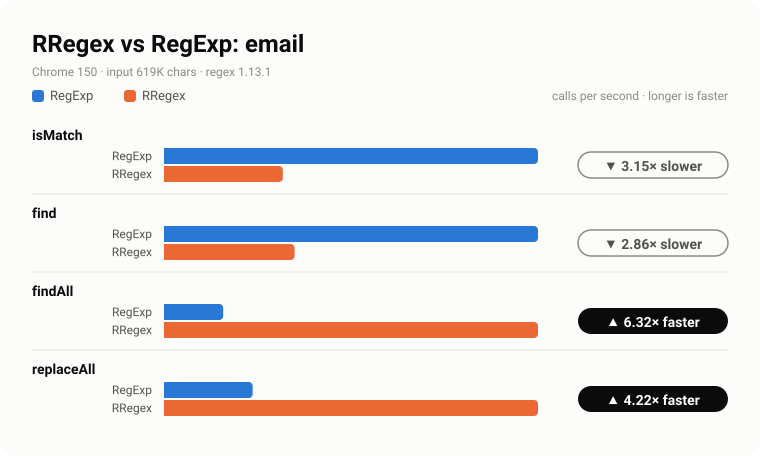
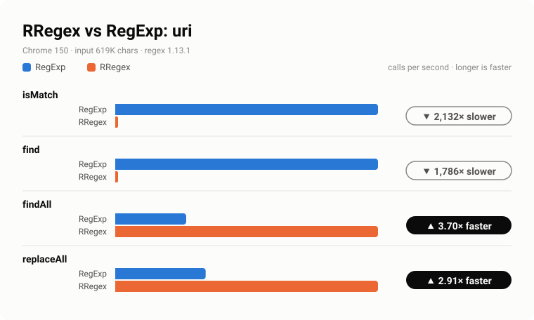
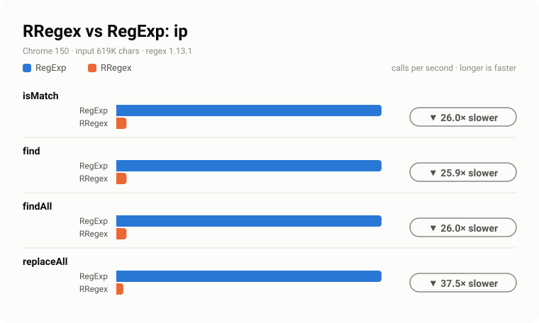
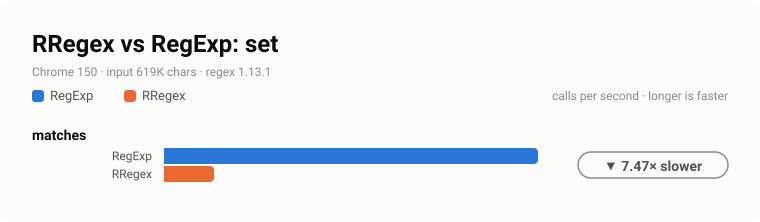

# rregex

A dependency-free WebAssembly build of [Rust Regex](https://docs.rs/regex/latest/regex/) for Javascript

  
[](https://jsr.io/@rregex/rregex)

- [Why Rust Regex](#why-rust-regex)
- [Install](#install)
- [Supported Runtimes](#supported-runtimes)
- [API](https://tsdocs.dev/docs/rregex/latest)
  - [`RRegex`](https://tsdocs.dev/docs/rregex/latest/classes/RRegex.html)
  - [`RRegexSet`](https://tsdocs.dev/docs/rregex/latest/classes/RRegexSet.html)
  - [`Match`](https://tsdocs.dev/docs/rregex/latest/types/Match.html)
  - [`Captures`](https://tsdocs.dev/docs/rregex/latest/types/Captures.html)
  - [`escape`](https://tsdocs.dev/docs/rregex/latest/functions/escape.html)
- [Benchmarks](#benchmarks)
- [Known Issues](#known-issues)

## Why Rust Regex

Rust has a powerful Regex library with a lot of features that don't exists en the standard `Regex` object

[See the official documentation](https://docs.rs/regex/latest/regex/#syntax) for more detail

## Install

```bash
  # NPM
  npm install rregex

  # Yarn
  yarn add rregex

  # PNPM
  pnpm add rregex

  # Deno
  deno add @rregex/rregex

  # JSR
  npx jsr add @rregex/rregex
```

## Supported Runtimes

This package includes builds for multiple runtimes

| Runtime            | Import                                                  | version    |
| ------------------ | ------------------------------------------------------- | ---------- |
| Node.js (esm)      | `import { RRegex, RRegexSet } from 'rregex'`            | `*`        |
| Node.js (commonjs) | `const { RRegex, RRegexSet } = require('rregex')`       | `*`        |
| Deno               | `import { RRegex, RRegexSet } from '@rregex/rregex'`    | `>=1.10.8` |
| Bun                | `import { RRegex, RRegexSet } from '@rregex/rregex'`    | `>=1.10.8` |
| Cloudflare Workers | `import { RRegex, RRegexSet } from 'rregex'`            | `>=1.10.8` |
| Browser            | `import init, { RRegex } from 'rregex/web'`             | `*`        |
| Standalone         | `<script src=".../rregex/lib/standalone.js">`           | `*`        |
| Any runtime        | `import { initSync, RRegex } from 'rregex/core'`        | `*`        |

The Node.js, Deno, Bun and Cloudflare Workers builds load the WebAssembly module
when you import them. The other builds do not: call `init()` or `initSync()`
once before you use `RRegex` or `RRegexSet`.

```ts
// Browser: fetches `rregex.wasm` from the same directory as `web.js`
import init, { RRegex } from "rregex/web";
await init();

// Standalone: exposes the global `rregex`
await rregex.init();
new rregex.RRegex("a+").isMatch("aaa");

// Any runtime: you provide the module (bytes, `WebAssembly.Module` or a `Response`)
import { init, initSync, RRegex } from "rregex/core";
initSync({ module: wasmBytes });
await init({ module_or_path: fetch(wasmUrl) });
```

## Benchmarks

**TL;DR:** use the native `RegExp` unless you need a feature of `rregex`. `rregex` wins only when it has to scan the whole input and the pattern makes `RegExp` backtrack.

### Results

Each case compiles the pattern once, before the benchmark, and runs one call on the same 619K-char input (10% of [`test/__data__/input-text.txt`](./test/__data__/input-text.txt), from [`mariomka/regex-benchmark`](https://github.com/mariomka/regex-benchmark)). Lower time is better. The ratio is `RRegex` time ÷ `RegExp` time: below 1× means `rregex` is faster.

| pattern | operation    | `RegExp` Node | `RRegex` Node |     ratio | `RegExp` Chrome | `RRegex` Chrome |     ratio |
| ------- | ------------ | ------------: | ------------: | --------: | --------------: | --------------: | --------: |
| email   | `new`        |             — |        521 µs |         — |               — |               — |         — |
| email   | `isMatch`    |        238 µs |        513 µs |      2.2× |          238 µs |          748 µs |      3.1× |
| email   | `find`       |        239 µs |        509 µs |      2.1× |          236 µs |          676 µs |      2.9× |
| email   | `findAll`    |       4.41 ms |        558 µs | **0.13×** |         4.52 ms |          715 µs | **0.16×** |
| email   | `replaceAll` |       4.39 ms |        801 µs | **0.18×** |         4.47 ms |         1.06 ms | **0.24×** |
| ip      | `new`        |             — |         92 µs |         — |               — |               — |         — |
| ip      | `isMatch`    |       35.6 µs |        747 µs |       21× |         35.4 µs |          921 µs |       26× |
| ip      | `find`       |       35.8 µs |        752 µs |       21× |         35.5 µs |          919 µs |       26× |
| ip      | `findAll`    |       35.0 µs |        759 µs |       22× |         35.1 µs |          913 µs |       26× |
| ip      | `replaceAll` |       34.8 µs |        968 µs |       28× |         35.4 µs |         1.33 ms |       38× |
| uri     | `new`        |             — |        257 µs |         — |               — |               — |         — |
| uri     | `isMatch`    |        400 ns |        513 µs |    1,284× |          330 ns |          703 µs |    2,132× |
| uri     | `find`       |        398 ns |        517 µs |    1,301× |          394 ns |          704 µs |    1,786× |
| uri     | `findAll`    |       3.61 ms |        788 µs | **0.22×** |         3.56 ms |          963 µs | **0.27×** |
| uri     | `replaceAll` |       3.50 ms |        884 µs | **0.25×** |         3.60 ms |         1.24 ms | **0.34×** |
| set     | `new`        |             — |        654 µs |         — |               — |               — |         — |
| set     | `matches`    |        276 µs |       1.93 ms |      7.0× |          280 µs |         2.09 ms |      7.5× |

> Node v24.19.0 and Chrome 150 on an Apple M4 Pro, `regex` 1.13.1. The `RegExp` equivalent of `findAll` is `Array.from(text.matchAll(re))`, of `replaceAll` is `text.replaceAll(re, '-')`, and of `set: matches` is one `test()` call for each pattern. `RegExp` has no `new` case: it compiles the pattern on first use.

<picture>
  <source media="(prefers-color-scheme: dark)" srcset="./img/rregex-vs-native-email-dark.svg" />
  
</picture>
<picture>
  <source media="(prefers-color-scheme: dark)" srcset="./img/rregex-vs-native-uri-dark.svg" />
  
</picture>
<picture>
  <source media="(prefers-color-scheme: dark)" srcset="./img/rregex-vs-native-ip-dark.svg" />
  
</picture>
<picture>
  <source media="(prefers-color-scheme: dark)" srcset="./img/rregex-vs-native-set-dark.svg" />
  
</picture>

### Conclusions

- **Each call has a cost before matching starts.** `rregex` copies the input from a JavaScript string (UTF-16) into the WebAssembly memory as UTF-8. On this input that copy takes about 0.5 ms on Node and 0.7 ms on Chrome. `new RRegex('^x').isMatch(text)` takes the same time as the other `isMatch` cases. The cost grows with the input length. On a 1K-char input, an `isMatch` call takes about 2 µs.
- **`RegExp` wins when the call can stop early.** `isMatch` and `find` stop at the first match. The first URI is at char 55, so `RegExp` returns in less than 1 µs and `rregex` is more than 1,000× slower. The difference is smaller when the first match is far from the start (email: 2–3×). The input contains no IP address, but `RegExp` rejects each position quickly and scans all of the input in 35 µs, less than a tenth of the time of the copy into WebAssembly.
- **`rregex` wins on full scans with backtracking patterns.** `findAll` and `replaceAll` must read all of the input. With the email and URI patterns, `RegExp` tries a match at almost every position and takes 3.5–4.5 ms. The Rust engine finishes in linear time, so `rregex` is 3–8× faster, even with the copy cost.
- **`RRegexSet` does not make a set of patterns faster.** On this input, `matches` is about 7× slower than one `test()` call for each pattern. Use it when you need the matches of many patterns in a single pass, not for speed.
- **Compile once.** `new RRegex` takes 0.1–0.5 ms and `new RRegexSet` 0.65 ms, about the same as one call. Keep the instance and use it again, and call `free()` when you do not need it.
- **Node and Chrome show the same pattern.** Chrome is up to 50% slower on the `rregex` cases. The `RegExp` times are almost the same in the two runtimes.

The time of `rregex` is predictable: the time to copy the input plus a time that is linear in the input length. The Rust engine has no catastrophic backtracking, so you can also use it with patterns from users that you do not trust. The time of `RegExp` depends on the pattern and on the input. It can be much faster or much slower than `rregex`.

> [!NOTE]
> `\w` matches only ASCII chars in `RegExp`, and Unicode chars in `rregex`. The patterns give the same matches on this input.

### Run the benchmarks

- **Browser:** run `pnpm build`, then `pnpm test:browser`, and open <http://localhost:8080/test/browser/bench.html>. The page shows the charts above and gives a Markdown table and SVG/PNG images of the results.
- **Node:** the same cases are in [`bin/bench-cases.mjs`](./bin/bench-cases.mjs). [`bin/bench-compare.mjs`](./bin/bench-compare.mjs) compares two builds of `rregex` with each other, and CI uses it on each pull request.

## Known Issues

If you call `splitn(text, limit)` and the expected result length is equal to `limit - 1` the result will include an extra item `""`, this behavior does not happen if `limit` es greater. **`fixed at >=1.3`**

```ts
const regex = new RRegex(",");
expect(regex.splitn("a,b,c", 0)).toEqual([]);
expect(regex.splitn("a,b,c", 1)).toEqual(["a,b,c"]);
expect(regex.splitn("a,b,c", 2)).toEqual(["a", "b,c"]);
expect(regex.splitn("a,b,c", 3)).toEqual(["a", "b", "c"]);

// This result includes an unexpected extra item
expect(regex.splitn("a,b,c", 4)).toEqual(["a", "b", "c", ""]);
expect(regex.splitn("a,b,c", 5)).toEqual(["a", "b", "c"]);

expect(regex.splitn("abc", 0)).toEqual([]);
expect(regex.splitn("abc", 1)).toEqual(["abc"]);

// This result includes an unexpected extra item
expect(regex.splitn("abc", 2)).toEqual(["abc", ""]);
expect(regex.splitn("abc", 3)).toEqual(["abc"]);
```
